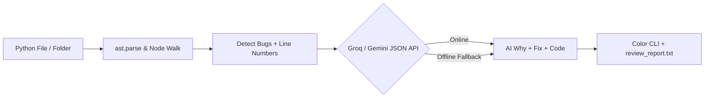

[project_documentation.md](https://github.com/user-attachments/files/33426459/project_documentation.md)
<div align="center">

# ⚡ VibeCheck: AST + AI Code Reviewer CLI

**A zero-dependency Python static analyzer & AI code reviewer with a Glassmorphic Web UI**

[](https://python.org)
[](https://docs.python.org/3/library/ast.html)
[](https://console.groq.com)
[-10B981?style=for-the-badge)](#)

*Built for **ANANTYA Mini Hackathon — Problem 8 (Code Reviewer CLI)***

</div>

---

## 🚀 Overview

Standard linters throw cryptic error codes that beginners struggle to fix. **VibeCheck** parses Python files into an **Abstract Syntax Tree (`ast`)**, pinpoints code quality and security bugs with exact line numbers, and queries **Groq (`llama-3.1-8b-instant`)** or **Google Gemini (`gemini-2.5-flash`)** in strict JSON mode to explain *why* the issue matters and generate *ready-to-use fixed code*.

---

## ✨ Key Features (Must-Haves + All Bonuses)

- 🔍 **10-Rule `ast` Static Analyzer:**
  - `LOW` Missing Function & Module Docstrings (`ast.get_docstring`)
  - `MEDIUM` Unused Variables in Function & Global Scopes (`ast.Store` vs `ast.Load`)
  - `MEDIUM` Deeply Nested Control Flow > 3 Levels (Recursive DFS)
  - `MEDIUM` Functions Too Long (>25 lines) / Too Many Arguments (>4)
  - `HIGH` Hardcoded API Keys, Passwords & Secrets (`ast.Assign`)
  - `HIGH` Mutable Default Arguments (`def fn(items=[]):`)
  - `HIGH` Bare `except:` Clauses & Unsafe `eval()` / `exec()` Calls
- 🤖 **Resilient AI Explanations:** Enforces structured JSON output (`why`, `fix`, `fixed_code`) with an **instant offline fallback** so demos never fail if Wi-Fi drops.
- 🎨 **Rich CLI + Web Companion:** Features an ANSI color-coded terminal report, ASCII Health Bar (`0–100`), folder-wide batch scanning, auto-saved `review_report.txt`, and a drag-and-drop **GitHub Pages Web UI**.

---

## ⚡ Quick Start (CLI)

**Zero installation required!** Uses only Python's standard library.

```bash
# 1. (Optional) Set your free Groq or Gemini API key
export GROQ_API_KEY="your_api_key_here"

# 2. Review a single Python file
python reviewer.py sample.py

# 3. Review an entire folder recursively (Bonus)
python reviewer.py .
```

### 🖥️ Sample CLI Output

```text
🔍 Scanning: sample.py
Health: [█████░░░░░] 51/100 (5 issues found)
------------------------------------------------------------
Line 1 | [LOW] missing docstring | calc()
  Why : Readers cannot tell what calc() does without reading its code.
  Fix : Add a descriptive one-line docstring.
  Code: """Describe purpose here."""

Line 2 | [HIGH] hardcoded secret | api_key
  Why : Hardcoded credentials expose secrets in version control.
  Fix : Use os.getenv() to load secrets safely.
  Code: api_key = os.getenv('API_KEY')
```

---

## 🌐 Live Web Dashboard (`index.html`)

Prefer a visual interface? Open `index.html` in any browser or visit our **GitHub Pages** deployment:
1. **Drag & Drop** any judge's `.py` file or project folder.
2. View interactive severity cards (`HIGH` / `MEDIUM` / `LOW`) and live Code Health Score.
3. Click **Download `review_report.txt`** to export the full audit.

---

## 🧠 How It Works


